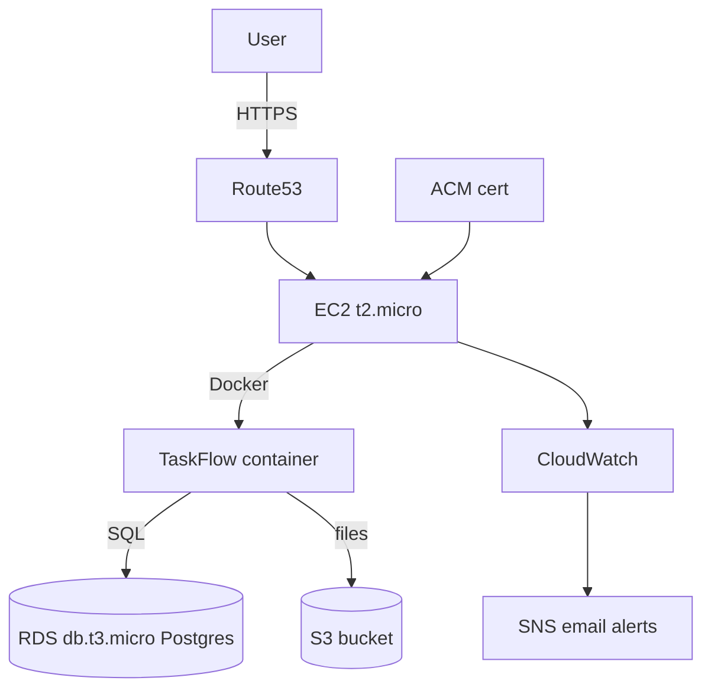

# TaskFlow

Task management web app (Node/Express + Postgres + React). **Status:** local + Docker ready. An AWS deploy workflow exists (`.github/workflows/deploy.yml`) but requires GitHub secrets (`AWS_*`, `ECR_REGISTRY`, `EC2_*`, etc.) and may be dormant — there is **no proven public live AWS URL** in this repo.

## Architecture



## Cost (~$0-5/mo on free tier)

| Resource | Tier | Cost |
|---|---|---|
| EC2 t2.micro | 750 hrs/mo free | $0 |
| RDS db.t3.micro | 750 hrs/mo free | $0 |
| S3 | 5 GB free | ~$0 |
| Route53 | hosted zone | ~$0.50 |
| CloudWatch/SNS | free tier | $0 |

## Getting started

Local:
```
cp .env.example .env
cd backend && npm install && npm run db:migrate && npm run dev
cd frontend && npm install && npm run dev
```

Or Docker:
```
docker compose up --build
```

## Deploy (AWS — optional / secrets required)

CI (`.github/workflows/ci.yml`) builds backend/frontend and runs tests with Postgres — that path is the portfolio-ready verification.

AWS end-to-end is optional:

1. Configure GitHub secrets (`AWS_ACCESS_KEY_ID`, `AWS_SECRET_ACCESS_KEY`, `ECR_REGISTRY`, `EC2_HOST`, `EC2_SSH_KEY`, `DATABASE_URL`, `JWT_SECRET`).
2. `cd infra/terraform && terraform init && terraform apply`
3. Push to `main` triggers `.github/workflows/deploy.yml` (ECR push + SSH restart on EC2).

Until those secrets and infra are active, treat AWS as a documented deploy path — not a live portfolio demo.

## Security

- IAM least-privilege instance role (ECR pull, S3 scoped, logs)
- Security groups: EC2 80/443/22, RDS only from EC2
- HTTPS via ACM + Route53
- Helmet, CORS

## License

MIT

## Teardown (keep it free)

```bash
cd infra/terraform
terraform destroy
```
Destroys all billable resources. RDS snapshot first if you need data. CloudWatch/SNS alarms are free tier.
